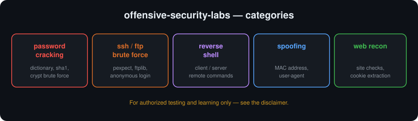

# offensive-security-labs

> Hands-on offensive-security scripts written while learning ethical hacking and penetration-testing fundamentals.

   

## ⚠️ Disclaimer — read first

These tools are for **education and authorized testing only**. Use them **only**
on systems, accounts, and networks you **own or have explicit written permission
to test**. Unauthorized access, password cracking, or scanning is **illegal** in
most countries. The author provides this code for learning and assumes **no
liability** for any misuse or damage.

## About

A collection of small, self-contained scripts that demonstrate how common
offensive-security techniques actually work under the hood — from password
cracking to reverse shells. Writing them from scratch is how I learned what
each attack does and, just as importantly, how to defend against it.

## Categories



## Repository structure

```
offensive-security-labs/
├── password_cracking/
│   ├── hash_generator.py     # Generate md5/sha1/sha224/sha256/sha512 hashes
│   ├── sha1_cracker.py       # Reverse a SHA-1 hash against a wordlist
│   ├── crypt_bruteforce.py   # Crack crypt(3) hashes with a dictionary
│   └── *.txt                 # Practice wordlists (not real credentials)
├── ssh_ftp_bruteforce/
│   ├── ssh_bruteforce.py     # Dictionary attack against SSH (pexpect)
│   ├── ssh_login.py          # Scripted SSH login + command
│   ├── ftp_bruteforce.py     # Dictionary attack against FTP (ftplib)
│   └── ftp_anonymous_login.py# Test for anonymous FTP access
├── reverse_shell/
│   ├── server.py             # Listener that drives a remote shell
│   ├── client.py             # Connects back and runs commands
│   └── simple_reverse_shell.py
├── spoofing/
│   ├── mac_address_changer.py / _v2.py  # Change a NIC's MAC address
│   └── firefox_user_agent_spoof.py      # Spoof the browser user-agent
├── web_recon/
│   ├── site_check.py         # Basic site availability / info check
│   └── cookie_info_extract.py
├── requirements.txt
├── WALKTHROUGH.md
├── LICENSE
└── README.md
```

## Getting started

```bash
pip install -r requirements.txt    # termcolor, pexpect
```

Run any script from its folder, e.g.:
```bash
cd password_cracking
python hash_generator.py
```

> **Notes:** `crypt_bruteforce.py` needs the `crypt` module (Python 3.12 or
> earlier, or `pip install legacycrypt`). The wordlists included are generic
> practice lists (e.g. "password123"), **not** anyone's real credentials.

## Skills demonstrated

- How password hashing and dictionary attacks work (hashlib, crypt)
- Automating interactive logins with `pexpect`
- Reverse-shell client/server networking with sockets
- Network/identity spoofing (MAC address, user-agent)
- Thinking like an attacker to understand defense

## License

Released under the [MIT License](LICENSE).
